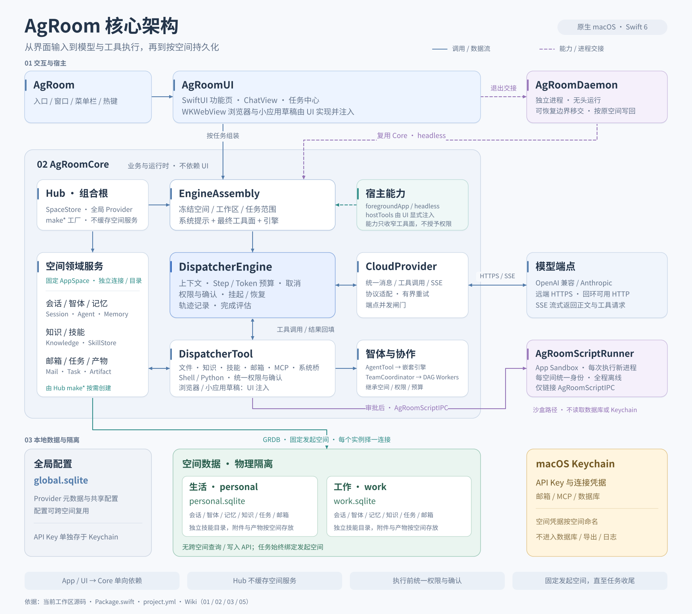

# 项目与架构

## 产品边界

阿吉屋（AgRoom）是面向个人使用的原生 macOS AI 工作台。用户主要与调度 Agent 对话，由它调用工具、加载技能、检索知识或委派智体完成任务。应用使用 SwiftUI 与少量 AppKit，不采用 Web 壳；数据以本地存储为主，只有模型推理和用户主动发起的网络能力会访问外部服务。

产品的核心隐私场景是生活空间与工作空间隔离。任何功能扩展都应先回答两个问题：数据属于哪个空间，以及切换空间后旧对象是否仍可能持有旧数据库或目录。

智体定位为主调度器可委派的专长执行者，可用于单次子任务或团队 Worker。独立选择提供商与模型是执行配置，不改变主调度器作为统一对话入口的定位，也不扩大智体的权限、上下文或任务预算。人设和技能属于智体所在空间；提供商配置全局共享，凭据仍只在 Keychain。

## 模块和依赖方向



[查看 SVG 原图](diagrams/agroom-core-architecture.svg) · [Mermaid 源图](diagrams/agroom-core-architecture.mmd)

```text
AgRoom
  ├── AgRoomUI
  │     └── AgRoomCore
  │             └── GRDB
  └── embeds AgRoomDaemon
          └── AgRoomCore
```

- `AgRoom`：应用入口、菜单栏、窗口和全局热键。
- `AgRoomUI`：SwiftUI 功能页、浏览器服务、样式和本地化。
- `AgRoomCore`：模型、空间、服务、调度运行时、工具协议与 LLM Provider。
- `AgRoomDaemon`：应用退出时承接允许后台继续的对话任务，并把结果写回空间数据库。
- `AgRoomScriptIPC`：Core 与独立执行器共享的有版本请求格式，不包含空间数据服务。
- `AgRoomScriptRunner`：独立 App Sandbox 执行源码；Xcode 为生活、工作空间分别生成统一的离线执行 App，供 Shell、Python/技能和环境变更共用。包解析也在离线执行器中运行，公开 PyPI 请求由主程序校验后传输。每次执行新建进程，Core 负责审批、授权目录和生命周期，执行器不链接 Core/UI，也不读取数据库或 Keychain。

依赖保持单向。Core 不知道 UI 的存在。浏览器工具依赖 WKWebView，小应用草稿预览依赖前台界面，因此实现在 UI 模块，由聊天组装点作为 `hostTools` 注入。App 显式传入 `EngineHostCapabilities.foregroundApp`，Daemon 与定时运行使用 `.headless`；`AgentTool` 的嵌套引擎继承同一宿主能力上限，直接构造时默认 `.headless`。因此后台委派也不会重新注册 OCR、转写或其他平台 UI 工具。前台普通对话的追加工作区目录请求由 Core 产生只读回执，App 负责之后的用户选择器；它同样受宿主能力约束，不是目录授权。Core 只识别能力与工具名，不引用 WebKit 或 UI 实现。能力描述只决定工具能否注册，不授予执行权限或改变确认策略。

工程 target、产品和第三方依赖的当前清单以 `AgRoom/Package.swift` 与 `AgRoom/project.yml` 为准。邮件协议栈的 `MailFoundation` 使用仓库内固定副本，来源与补丁见 `AgRoom/vendor/MailFoundation/AGROOM-PATCH.md`；`MimeFoundation` 在这两份清单和固定副本清单中使用同一 revision，解析结果同步锁定到两份 `Package.resolved`。

## 邮箱模块

邮箱能力分三层，边界与其他领域一致：

- `AgRoomCore/Services/Mail`：账号与凭据（`MailAccountService`）、本地读写（`MailService`）、IMAP/SMTP 编排（`MailSyncService`）。
- `AgRoomCore/Runtime/MailTools.swift`：智体工具，复用同一批空间服务。
- `AgRoomUI/Features/Mail`：三栏功能页与账号配置、独立撰写窗口。

`MailFoundation` 仅由协议适配器 `MailFoundationAdapter.swift` 引入；`MimeFoundation` 用于该适配器的报文编解码、`MailHeaderText.swift` 的头部文本解码，以及同步服务已有的 MIME 扩展名回落。 SMTP 的隐式 TLS 由该适配器使用网络组件已有的 `startSecure` 能力接入，必须先启用 TLS 再读取 SMTP 欢迎信息；探测与实际发信共用此连接路径。连接握手期间即保留可关闭的底层连接，超时先断开字节流，避免等待协议层的优雅退出阻塞收尾。Core 其余部分只依赖自有的 `MailProtocolClient` / `MailSendClient` 协议与 DTO，测试用内存 mock 即可覆盖同步与写操作编排。

**文件夹路径契约**：`listFolders()` 返回并落库的 `path` 是服务器 `LIST` 的**原始名**（Modified UTF-7 可能仍处于编码态），本地库、业务服务与 DTO 一律保留这个原始形态，不做迁移。协议方法收到的路径同样是原始形态；`MailFoundationAdapter` 在调用边界统一经 `sessionMailbox(from:)` 解码为 Unicode 后再交给会话层（`AsyncImapSession` 会按需编码），避免二次编码导致中文等非 ASCII 文件夹的全部命令失败。

**失败诊断**：适配器把底层会话错误集中映射为项目自有的 `MailServerDiagnostic`（操作阶段 + 服务器状态 `NO`/`BAD`/`OK` + 脱敏说明 + 失败类别 + 文件夹显示名），其余 Core 与 UI 只依赖该类型；`MailProtocolError` 的超时等语义保持原样，`CancellationError` 继续上抛不做包装。协议适配器不假设路径已是最终线路形态，也不在上层分散解码。

邮箱账号与邮件数据属于所在空间：服务绑定当前空间的 `DatabaseQueue`，密码 / 授权码按「空间 + 账号 id」进 Keychain。账号配置、发信与删除沿用既有确认策略，不新增绕过入口。

## 组合根

`AgRoomCore/Hub.swift` 是应用服务的组合根：

- `SpaceStore` 管理当前空间和数据库连接。
- `ProviderConfigService` 使用全局数据库，可跨空间共享配置。
- 会话、智体、技能、记忆和知识服务由 `make*` 方法现取现建。

**空间内服务不得缓存在 Hub。** 缓存会让空间切换后的对象继续持有旧 `DatabaseQueue`，形成跨空间串写风险。新增服务时，应让构造函数接收单一空间的数据库或目录，而不是让服务自行访问全局空间状态。

## 空间隔离

```text
~/Library/Application Support/AgRoom/
├── global.sqlite
├── personal.sqlite
├── work.sqlite
├── workspaces.json
├── personal/skills/
├── work/skills/
└── daemon/
    ├── daemon.lock
    ├── store.lock                  # 新版 Store 的短时文件变更互斥
    ├── personal/                  # 新运行的快照、owner、日志与隔离证据
    ├── work/                      # 与 personal 独立
    └── <旧根目录残留>             # 兼容读取，尚未整体迁移
```

- `global.sqlite` 只保存跨空间配置，例如 LLM Provider 元数据。
- `personal.sqlite` 与 `work.sqlite` 保存各自的会话、智体、记忆、知识和邮箱数据。
- `workspaces.json` 保存对话工作区注册表（名称、主目录、引用文件夹与空间归属），工作区列表按空间隔离。对话仅挂载当前工作区的主目录与显式引用文件夹；其他登记目录不会自动授予访问。默认工作区位于 `default-chat/<space>`，引用目录通过系统选择器授权；过宽或含系统/应用私有数据的目录被拒绝。
- `workspace_folder_draft` 的回执只记录从当前执行上下文冻结的空间、工作区和会话身份，以及模型提供的有界说明；模型不能指定目录路径或归属身份。回执本身不登记目录、不扩大当前运行的文件范围，只有用户在系统选择器中明确选择后，后续新组装的对话才会看到新增引用目录。
- 技能、附件等文件同样按空间放置。
- AgRoom 使用独立的应用支持目录、文稿目录、备份目录和钥匙串服务，可与原版共存（见 [05](05-数据模型存储与知识库.md)）。
- `SpaceStore.currentQueue` 是构造当前空间服务的入口。
- UI 在切换空间后重建空间相关功能页；聊天与邮箱模型按空间缓存，旧空间任务可能仍在运行或收尾。因此所有服务与后处理都必须绑定发起空间，不能在迟到回调中从 `current` 重建依赖。当前聊天后处理仍有遗漏，见 [专项审查 A01](reviews/2026-10-10-稳定性性能与架构审查.md)。

新增数据默认按空间隔离。只有明确不含用户隐私且需要跨空间共享的设置，才进入全局存储。不要新增同时接收两个空间连接的服务，也不要通过 SQL、文件路径或缓存绕开隔离。

## 一轮对话的数据流

```text
用户输入
  → UI 读取当前空间的 Provider、智体、技能、知识和记忆
  → EngineAssembly / 聊天组装点按宿主能力、任务范围与工具过滤构建最终工具面及系统提示
  → DispatcherEngine 请求 LLM
  → 无工具调用：完成并持久化
  → 有工具调用：执行、确认或挂起，结果回填后继续循环
  → 最终正文、轨迹、思考和用量写回当前空间数据库
```

活跃引擎内的确认和提问可以沿原调用身份恢复；仅有展示快照的重启卡只能供核对，不能替代原审批。应用退出续跑时，UI 先原子认领可移交的完整快照，确认交接记录写下后把执行权交给 daemon，并阻止旧 App 回调和延迟保存覆盖后台写回。记录带持久状态机（待领取 → 执行中 → 结果待提交 → 完成，以及与用户交互的挂起态和「需人工恢复」），每次状态变化整条原子替换落盘。顶层非只读工具执行前后落 intent/回执；只有运行、空间、模型轮次、工具和参数 SHA-256 摘要全部匹配的回执才可复用。子代理按父调用保存独立子快照。Daemon 可为身份一致且已正常结束的单一子运行补齐父回执和消息。其余未决写入、占位结果和无法配对的工具批进入人工恢复。Daemon 只在终态或挂起态可靠写回后删除记录。

新的 Daemon 交接快照、owner、执行日志和隔离证据写入所属 `personal/` 或 `work/` 目录；全局根保留单实例锁和新版 Store 的短时变更锁，并兼容读取尚未迁移的旧根记录。Daemon 按记录的固定来源原地更新旧任务，同空间旧新重复、owner/正文冲突或无法归属的证据阻止自动领取，交由任务中心人工核对。独立的只读旧根盘点器可列出历史文件并给出文件级身份佐证；单空间数据库探针与纯计划器只提供预检建议，不移动原件或授权迁移。真正迁移仍缺旧版本写者停机证明、持久标记、发布前数据库重验和故障注入。这个切片阻止**新增**混放，旧根内容尚未完成物理迁移，不能宣称所有历史运行凭证已按空间隔离。退出时 App 等待带随机 token 的 READY 回应，确认新 Daemon 进程已打开锁文件并准备等待旧进程释放；这只证明当次进程已就绪，不能保证其后不会崩溃或任务必定完成。详见 [空间分区设计](design/2026-daemon-space-storage-migration.md) 与 [改进清单](10-改进清单.md)。

## 并发模型

- `Hub`、`SpaceStore` 和 SwiftUI 状态由 `@MainActor` 管理。
- 引擎内部共享状态使用短临界区锁保护；锁内不做 I/O、回调或 await。
- 网络、数据库、文件和子进程操作在异步边界执行，回到主 actor 更新 UI。
- 运行、停止、恢复和 daemon 交接必须有清晰的任务身份，旧任务不得清理或覆盖新任务状态。

## 跨领域安全规则

- API Key 只由 `KeychainService` 保存和读取。
- `EndpointSafety` 强制远端 HTTPS，只允许本机回环地址使用 HTTP。
- 文件工具受 `FileAreaPolicy` 和标准化路径检查限制。
- 用户内容、网页、文件、OCR、转写和工具结果进入模型时都按外部数据处理，保留提示注入边界。
- 原生权限能力留在宿主服务。脚本、技能或网页只能调用明确暴露的工具/桥接 API，不能假设拥有宿主的 TCC 权限。
- 生产日志统一使用 `HubLogger`，不记录密钥和未脱敏内容。

## 长期设计决策

- 调度采用 LLM function calling 与确定性执行引擎结合：模型选择能力，引擎负责预算、确认、执行、恢复和记录。
- 工具的定义、确认策略和执行是独立契约；参数级确认必须通过协议动态派发。
- 对话 step 预算跨确认与恢复共享，避免通过反复挂起绕过上限。
- 子代理使用嵌套调度引擎，并把确认和轨迹逐级传回宿主用户。
- 多智体协作是任务级 DAG + 隔离 Worker + 版本化黑板，不是多智体群聊；P0 只读，P1 增加空间库快照、任务板与独立验证，P2a 增加工作区内受控写、逐次审批与路径级写租约，P2b 增加写快照与单文件回滚，P2c 增加整任务批量回滚，P3a 增加任务板实时进度，P3b 增加 Provider 端点并发闸门与计划 Token 估算；Shell/邮件/删除等外部副作用仍属于后续阶段。
- 技能目录就是脚本工作目录；技能声明只能收窄工具面，不能扩大权限。
- 历史实现过程由 Git 保存，Wiki 只维护当前有效的决策和约束。

