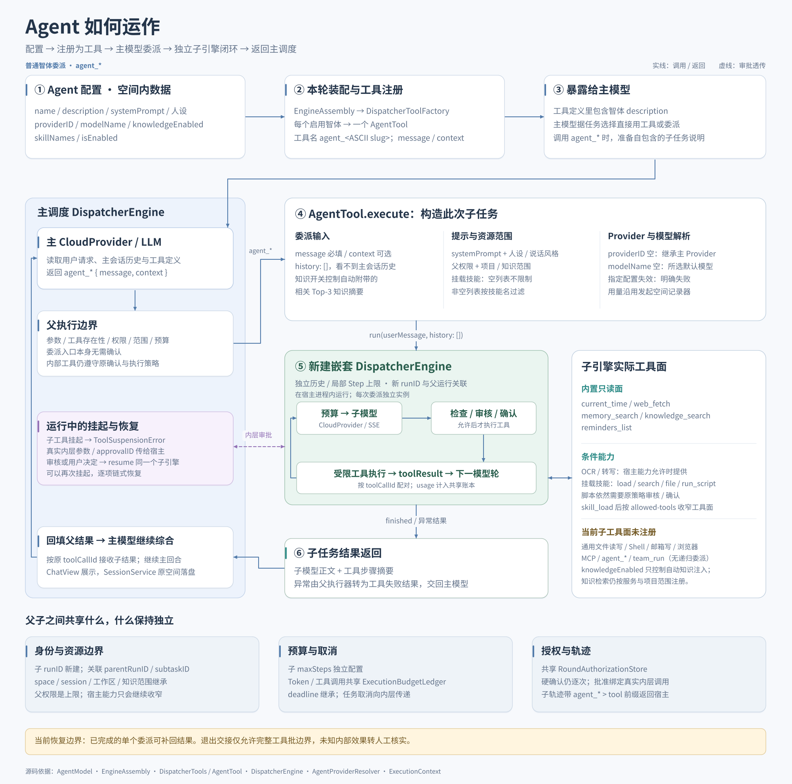

# 调度引擎

聊天追问按完整问答轮分配历史预算。引擎先扣除实际系统提示、当前输入和工具定义，再尝试恢复所选回答的原始模型消息。真实调用和结果成对进入下一次请求，历史调用不经过执行器。保存的协议数据限于单轮、最多 1 MiB，包含图片、未完成或无法配对的轮次使用可见对话。附加数据绑定空间、会话、提供商、端点、型号、资源范围、问句与回答。加密或签名输出还校验前置消息和工具定义；条件变化时使用可见历史。DeepSeek 带工具且开启思考时，缺少原始推理的旧答以引用文本传递。切换历史版本会清除后续回答的协议数据，创建分支和可移植备份时清除所有版本的协议数据。

核心实现位于 `AgRoom/Sources/AgRoomCore/Runtime/DispatcherEngine.swift`。引擎把模型生成的不可信工具请求转换为有预算、可确认、可追踪和可恢复的执行过程。

## 核心契约

- `EngineMessage`：统一的 system、user、assistant 和 toolResult 消息。
- `DispatcherTool`：工具定义、确认策略和异步执行入口。
- `DispatcherTraceEntry`：记录工具、参数、结果摘要、耗时和成败。
- `DispatcherOutcome`：完成、等待确认、等待用户输入三种结果。
- `ToolSuspension`：工具内部挂起后继续执行的恢复句柄。
- `EngineSnapshot`：应用退出或跨进程继续时使用的可序列化运行快照。

## 主循环

引擎按请求顺序保留模型完整返回的推理文本和工具轮中间叙述，结束与移交使用同一份思考记录。推理用量另存服务商上报值与覆盖情况，随运行快照恢复；旧快照缺该字段时按未知处理。流式预览不在终态再次拼接，推理回填的正文也不重复记为工具轮叙述。

```text
run / resume
  → 组装本轮有效消息和工具定义
  → 请求 CloudProvider
  → 累积正文、思考、工具调用和 token
  → 没有工具调用：可用能力缺失声明可触发一次只读目录纠错，否则 finished
  → 有工具调用：检查工具存在性、权限和确认策略
      ├── 可直接执行：并行执行允许并行的调用
      ├── 需要确认：needsConfirmation
      └── ask_user：waitingForInput
  → 将工具结果按 toolCallId 回填
  → 下一 step，直到完成或耗尽预算
```

模型返回的工具名和参数始终是不可信输入。未知工具、非法 JSON、越权工具或不安全路径必须转化为模型可见的失败结果，不能直接崩溃或绕过策略。

常规对话的工具指导取自本轮最终注册的工具名：宿主能力、白名单、排除名单与项目范围过滤后，才决定浏览器完整流程、内容管理、团队、系统桥等提示段是否出现。平台工具由 App 显式声明能力并注入，Daemon 与定时运行不声明前台能力；提示词不能把未注册的工具描述成可调用。`workspace_folder_draft` 仅在有会话身份的 App 前台普通主对话、无定时或显式工具白名单时组装，且其空间与工作区来自装配时已核实的当前工作区。它只返回只读请求回执，不修改目录注册表或运行中的任务范围。`AgentTool` 从主引擎继承宿主能力并在嵌套工具面再次过滤；直接构造的子代理默认无头，不能经委派重新获得后台缺失的 OCR、转写或 UI 工具。能力筛选只缩小工具面，确认与执行仍由同一 `DispatcherEngine` 路径处理。

工具定义与工具专属提示采用同一轮路由结果。`ToolPromptModule` 按实际注册能力构造，再随直接披露的工具选入首轮系统提示；未选入的浏览器、技能创建、文档制技能、工程、团队和外部服务等说明随 `tools_search` 的 `tool_guidance` 按需返回。工具描述仍是不可信数据，使用规则只取宿主构造的模块。压缩或恢复后，参数定义与对应使用规则均完整且与当前装配一致，才恢复该工具的发现状态；缺失时重新发现，不改写已签名的消息或工具定义。

没有具体操作与日期需求的普通对话，首轮仅直接提供工具发现入口；显式提到或项目优选的启用技能可补入技能读取工具。网页与登录/填表等信号可以补选现有浏览器入口，相对日期补入时间工具。身份、语言、人设、当前项目上下文、相关记忆、权限与任务硬约束持续保留。空资源注册表不再附带说明，技能创建和工程操作指引不在问候轮常驻。分类器返回不确定时，框架可依据明确动作、浏览器操作或音频附件补选当前可用的工具。只有“把刚才那个处理一下”这类指代时，优先提供澄清入口。其余缺少线索的请求以及分类器停用时沿用原有工具面。

按需披露在普通、工程和目标模式中都提供当前可用能力的目录。模型声称缺少一项尚未发现的能力时，引擎在剩余步骤预算内最多补查一次目录。用户明确指定邮箱、知识库或图片文字时，引擎还核对实际读取的来源。若模型从其他来源得出结论，可要求它改查指定来源。两类纠错共用一次机会，次数随运行快照恢复。纠错后仍只有其他来源的证据时，任务按未完成收尾，界面提示用户核对来源。

查找后保存邮件草稿、操作邮件或创建提醒时，引擎先检查来源回执，再走原有审批。用户拒绝过的同一工具和参数即使换了调用 ID 也无法重试。投递结果不确定时，写入暂停，交由用户核实。

## Step 预算

目标执行在引擎上层由空间绑定的 `GoalCoordinator` 决定是否启动下一段。每段沿用本引擎的审批、提问及单段执行保护；目标不设累计预算，历史用量只作统计，不作为新段的已消费额度。宿主从 `stopReason` 读取结构化终止原因，并结合检查点与新证据决定续跑，不把 `.finished` 或模型完成声明当作目标达成。详见 [目标执行](19-目标执行.md)。

一次模型请求消耗一个 step。预算属于完整的一轮运行，跨确认、提问和恢复共享。确认本身不额外消耗发起该调用的 step，但恢复后继续请求模型会继续消耗预算。

达到预算上限时，引擎应给出明确、可持久化的终止结果。不要在 resume 时新建不受原预算约束的循环。

团队 Worker 的单次最大输出为 8,192 Token，主助手或智体模型配置较小时取较小值。可调度 `team_run` 的主对话与团队默认只统计累计 Token。开启任务预算或显式设置团队局部上限后，每轮请求按输入估算加最大输出预留额度。Worker 后续失败或挂起时，报告保留已累计的模型用量、工具调用和已有产物。任务板按当前语言解释新旧快照中的预算错误。

## 工具确认

引擎把每次工具调用的确认判定收敛为结构化的确认需求（类型 / 范围 / 硬确认原因 / 本轮授权键 / 持久规则候选），UI 只据此决定按钮语义与说明文案，不各自推断。判定按以下层次：

0. **无副作用的参数校验**：无效调用直接产生失败 toolResult，不进入确认队列，也不创建执行环境；实际执行前再次校验，不能把“无需确认”解释为“允许执行”。
1. **权限模式天花板与任务范围**（会话级：仅可查看 / 工作区内修改 / 扩展访问）：模式或任务范围拒绝直接写 toolResult，不进入确认队列；任何 hard、持久规则、本轮授权、确定性规则或模型审核都不能放行。
2. 必须逐次确认的 hard confirmation：命中即逐次必问，不提供本轮授权键与持久规则，命中任何授权也不放行。
3. 有权限模式策略且调用被核验为只读能力：免确认；不要求开启自动审核。
4. 工作区任务授权有效、工具声明为 `.deterministic` 且规则能证明低风险：直接执行并写审计，不弹成功提示。
5. 命中持久精确规则（跨轮「始终允许 …」）或本轮精确授权键：免确认并记录来源。
6. 工具声明为 `.modelReviewable` 且执行档/证据可核验：交给无工具的审核模型判断；批准、转人工或拒绝，模型不能推翻模式拒绝、空间隔离或硬确认。
7. 其余工具确认要求（静态或按实际参数动态判定）：产生普通确认，携带「工具 + 范围」授权键与可选的持久规则候选。

模式判定与 `FileAreaPolicy`、执行使用同一份解析后的参数，避免确认、审核与执行看到不同目标。模式的完整语义见 [12-权限模式](12-权限模式.md)。

同一工具批只生成一次确认分类，已执行的免确认调用不会因随后状态变化再次排入确认队列。实际执行和批准恢复仍复核参数、任务范围、执行身份与授权世代。

工具默认不支持本轮批量授权，只有显式声明安全范围的工具才提供授权键。Shell 绑定可确定解析的单条命令身份与目录/空间；技能绑定冻结输入包和环境修订号；文件写入为工作区根。浏览器原生链接导航可按空间、标签、准确来源与授权世代复用本任务授权；填表仅复用同一文档中完全相同的字段批次和值。任务授权键与每次读取快照的执行身份分离，重读只更新执行证据；提交、未知点击和任意 JavaScript 仍逐次硬确认。普通 Python 与包管理不提供整工具本轮授权。执行器再次核验批准时的身份，异步准备或输入变化后要求重新批准。

授权分两层，期限不同：

- **本轮授权**（`RoundAuthorizationStore`）：只属于当前一轮运行，不写 `UserDefaults`、不跨轮、不跨重启；宿主引擎与子代理引擎共享同一实例，同一轮内宿主已授权的范围在子代理内同样免确认。
- **持久精确规则**（`ShellApprovalRuleStore`，即 Shell 确认卡上的「始终允许 …」）：按空间落盘为可读 JSON，跨轮、跨重启生效；只有能确定解析为无展开的单条命令才产生候选；命中后直接执行解析后的绝对路径与 argv。

硬确认不受上述两层授权中的任何一层影响。

### 自动审核

自动审核由会话权限预设选择，运行、挂起与后台执行期间不能从界面切换预设。引擎仍在每次执行前核验有效设置与授权世代。运行上下文使用审核世代丢弃关闭、重新开启、停止或换轮前发起的旧结果；自动放行在恢复执行前再次检查世代与队首调用身份。工作区使用本轮启动时绑定的路径，不能因界面切换而改变审核范围。

前台与守护进程均调用 `DispatcherEngine.reviewPending` 与 `AutoReviewService`。所有待确认调用（包括硬确认、未声明资格和内部挂起）都产生明确的放行、转人工或规则拒绝结论，并按空间记录脱敏原因。规则拒绝使用独立恢复输入，回填真实规则原因，不能伪装成用户拒绝。

- 工具默认仅人工；只有显式声明资格、通过参数和路径规则的调用才能自动放行。当前支持会话工作区内的新建文件、目录、带恢复点的已有文件单项或批量编辑、改名、复制、移动、移入系统废纸篓，以及严格解析的沙箱只读单命令（含经过硬化的 git 只读子命令）。固定的 `repo_changes` 通过只读权限判定免确认。离线 Python/技能脚本可由模型审核；复合脚本、显式宿主执行、永久删除、外发与宿主构建仍不能自动放行。
- 外部 MCP 的查询候选可接入模型审核，仍保留外部副作用与非幂等分类；候选筛选不直接批准。审核证据绑定空间、服务、端点、配置修订、远端定义指纹和当前参数，远端描述与 Schema 明确作为不可信声明。审核模型只批准符合本次查询意图的现有服务数据读取，不批准写入、外发或其他动态操作。配置、定义、审核世代与运行身份仍在执行前复核；不新增批量或持久授权。
- 硬确认始终优先，不受自动审核或已有授权影响。审核器的判断规则和 JSON 返回格式放入系统消息，用户请求和调用证据作为数据单独发送。返回格式、调用摘要或授权引文不符时记录具体原因并交给用户确认。确定性规则能证明低风险时不会为每次调用请求模型。
- 子代理挂起通过回调透传内层真实队首请求，恢复仍由内层引擎核对调用身份与资格；不能把宿主工具参数当成内层操作，也不能一次批准整个子流程。子代理通过 `ExecutionContext.child` 继承父任务范围，只能取更窄的能力和目录。
- 自动审核开关随退出移交设置传递，旧记录缺省关闭。后台 Shell 按执行档区分：只读沙箱单命令可按规则执行，宿主执行与写命令仍人工；其他符合规则的调用可按同一审核流程续跑。
- 重启后只有展示快照、没有原内存引擎的确认卡和提问卡只供核对，不再提供原操作的批准或答复入口，也不把按钮选择变成一条新的模型消息。用户可查看已保存轨迹，明确「结束等待」后才在同一会话事务中清除挂起快照、把原回答标为 `recoveryRequired`；落库失败保留卡片。正常活跃引擎仍按原审批 ID 或表单恢复。

确认卡展示即将执行的真实参数。代码、SQL、路径和变更预览不能用省略后的文本替代。拒绝也要形成对应 toolResult，使消息协议保持配对。

## 挂起与恢复

`.needsConfirmation` 保存工具名、调用 ID、参数展示、可选变更预览和确认需求；`.waitingForInput` 保存结构化问题表单。恢复输入包括批准、拒绝、回答或取消。

恢复必须满足：

- 原工具调用与工具结果严格按 ID 配对。
- 一次恢复只处理队列首项（普通确认或工具挂起），其余保留排队、逐个批准，避免「只展示队首却把整队一次批准」。
- 人工批准绑定当前挂起项的进程内唯一身份；旧卡片、重复提交、无身份输入和表单回答不能批准另一个操作。执行前复核确认时的参数、资源摘要和执行身份；内部子代理确认也逐层绑定原挂起项。
- 「本轮允许此范围」在恢复时用首项调用的参数计算授权键写入本轮记录。
- 多阶段确认继续沿用同一个运行预算和轨迹。
- 子代理内部挂起通过宿主引擎传给用户，不能在子代理中私自批准。
- 普通智体委派在直接完成和确认恢复时都返回同一份结构化结果，包含子运行与智体 ID、完成评估、停止原因、产物版本和答复。达到步数或预算上限时标记为部分结果，普通问答可正常结束且完成评估为「未评估」。
- 重启恢复只从完整检查点继续；存在尚未完成的外部副作用时，必须先判定是否可安全重放。

对话执行身份随消息和回答版本持久化，区别于用于界面定位的消息 ID。暂停后继续执行沿用身份与预算，重试另建身份。daemon 的进度与最终写回检查预期执行 ID；终态后迟到的流式片段被丢弃。独立任务历史与消息在同一事务中更新，不能因展示另一回答版本而回退已经完成的回执。

## 副作用日志与工具批检查点

守护进程侧注入 `OperationJournal` 后，按本次参数判定为非只读的工具遵循「先落盘、后执行」。`sql_query` 在绑定空间库上预编译单条语句并校验绑定参数后分类；预编译失败或无法证明只读时保守进入副作用路径，不能凭 SQL 首词跳过确认或日志。引擎冻结本次是否写 intent 的分类并传给执行器；若当时免确认的 SQL 在实际执行前被识别为写入，执行器拒绝升级：

- **intent 必须先确认写到磁盘**（带运行、空间、模型轮次、工具和参数 SHA-256 摘要的 `recordIntent` 返回是否成功，失败重试三次），才允许执行工具。写不进去时工具**不执行**，把「未执行 + 原因」交给模型并置位 `_journalUnavailable`；之后同轮所有副作用调用也拒绝。
- 同批重复或空 `call.id` 在确认分流与并发执行前整批拒绝；日志中的身份冲突或未决操作也先预检整批，避免新 ID 写入与冲突调用并行。带日志的副作用调用顺序执行。跨模型轮次复用 ID 不能冒充旧调用。
- 恢复（`run(fromSnapshot:)`）时：仅完整身份匹配的 receipt 可复用结果且不重放；只有 intent、旧 `len=N` 日志、未知版本、运行/空间不符、非空 `pendingToolCallIds`、未决挂起占位结果或工具调用与结果未配对，均转 `recoveryRequired` 并保留移交记录。Daemon 使用持久运行 ID，避免无任务授权时重启生成新身份。
- Daemon 在工具循环正常返回及异常收尾时都再次检查日志、引擎标记和最终快照；receipt 写盘失败、未决 intent 或批中检查点会保留交接记录并转人工，不进入提交/删除分支。
- Daemon 正常运行中产生、尚未执行的普通确认可以进入等待确认；只有可识别的实时顶层 `ask_user` 表单可以进入等待输入。嵌套挂起、旧占位快照及重启后的展示卡不能借这两种实时等待状态绕过失败关闭。
- 日志落盘用同目录临时文件加原子替换，不吞错误。
- 轮内维护**工具批检查点** `_inFlightToolCallIds`，与助手消息中的 toolCalls 一次性置位；工具挂起队列和清批标记也在同一锁内变更。`EngineRunSnapshot.pendingToolCallIds`、`suspendedToolCallIds` 和 `journalUnavailable` 随快照保存。旧快照缺字段可解码，但旧占位结果和未配对调用仍由消息结构检查失败关闭。Daemon 检查点写入是工具启动前的同步屏障：写失败即停止后续副作用。子代理挂起后最终结果会补外层 receipt；再次挂起仍保持未决。
- 退出移交只允许发生在**工具批边界**（`isAtRecoverableBoundary`）：确认恢复（包括自动批准与子代理续跑）也计入工具批；有待确认队列、未配对调用或占位结果时同样不允许移交。App 通过一次性 claim 在同一锁区间冻结边界和快照，写下交接记录后才把执行权单向交给 Daemon；可证明记录不存在时才释放 claim。已交接会话的本地流式回调、收尾和旧世代延迟保存不能覆盖 Daemon 写回，直到权威数据库重载才解除本地写入门禁。存储故障使交接记录是否落盘不可判定时，本地停止以防双执行，保留已有文件供人工核实。
- 工具面包含远程 MCP 的运行暂不移交；MCP 客户端与批准只用于前台主对话。守护进程、定时与子代理组装保持关闭，不能在恢复时自动重放远端副作用。
- 委派期间，父快照内的独立子检查点保存内层消息、工具批边界及最终回执。Daemon 只在单个外层调用、完整子结果、同一空间和会话、原始调用身份与持久日志均匹配时补齐父结果。补写可重复执行，内层工具只执行一次。未决内层写入和中断的审批继续交人工核实。

新交接记录、owner、日志和隔离证据写入所属空间的 `daemon/personal/` 或 `daemon/work/`；Daemon 读取记录时携带固定来源，旧根目录的历史记录只在原位置更新或收尾。相同 ID 在两空间独立，同空间旧新双份、归属冲突或无法归属的旧证据阻止自动领取。任务中心对已归属恢复、空间内未知证据和旧根未归属证据提供各自受限的查看/放弃入口；同空间重复凭证只显示人工核对警示，不从某个空间页面打开可能含另一空间旧文件的共享根。旧根文件尚未整体迁移。退出时的 READY relay 以随机 token 证明新 Daemon 进程已打开全局锁并准备等待原进程，随后仍可能崩溃；它不保证跨进程任务必然完成。App 启动与运行中的监督会对剩余可执行记录尝试补拉，不能把 READY 视为持久执行回执。

## 工具执行与轨迹

允许并行的无确认工具可使用结构化并发执行。需要顺序、共享状态或用户确认的调用保持串行。每次执行都记录稳定的调用身份、参数、结果、时长与错误。

轨迹用于用户理解和恢复诊断，不能成为保存敏感原文的旁路。预览可以截断，完整结果也必须设置明确上限。

单次轨迹可携带多个真实成果引用。每个工具调用使用独立收集器，成果内容存所属空间的版本表，不复制进工具输出或全局缓存；日志回放按运行与调用身份加载已存引用，不重做写入。运行快照另外保留本轮显式附件的输入版本 UUID，子引擎可继承同空间来源标识。来源关联仅用于回看，不是执行权限、自动批准或扩大工作区读取的依据。

每轮模型请求另写一条有限的结构化诊断日志（`HubLogger`）：请求序号、`finish_reason`、正文长度、推理长度、工具调用数、是否使用推理回填、本次与累计输入量。日志不记录密钥、完整提示词或文件正文。

模型停止调用工具时的收尾判定，分两层：

- 协议层（先判）：带工具的执行请求若只返回推理、没有正文也没有工具调用，按 `reasoningOnlyResponse` 失败关闭（「只说准备做、界面却结束」正是这种情形）；`finish_reason = tool_calls` 却没有工具调用按 `toolCallFinishMismatch` 失败关闭。两者都不纳入自动重试。
- 完成层（后判）：`succeeded` 只表示引擎正常结束；「用户要求的任务是否完成」需要额外依据。引擎收集本轮 `skill_run_script` 的实际执行回执，并读取技能声明的产物契约校验结果（由工具在真实目录上做文件校验后以标记行回执），得出 `TaskCompletionAssessment`：

| 实际状态 | 收尾行为 |
|---|---|
| 普通聊天（无产物契约） | `.unassessed`，正常结束 |
| 技能产物契约校验通过 | `.completed`，展示成果 |
| 技能已开始执行但缺少必需产物（脚本失败 / 产物缺失或不合法） | `.incomplete`，展示阻塞原因 |
| 等待操作批准 | 沿用待确认状态 |
| 用户取消 | 取消收尾 |

判定只依据实际执行回执与文件校验，不从模型自然语言里猜路径；旧文件不能充当本轮产物（产物 mtime 必须晚于本次执行起点）。完成评估写入轮内状态，随 `EngineRunSnapshot.completion` 交给接管方（守护进程恢复提交时据此落库，旧快照缺该字段按「未评估」兼容），并经 `DispatcherOutcome.finished` 交给界面与定时运行（App 与 Daemon 同一语义；无人值守运行不把未完成报成成功）。模型修复机会仍是常规工具循环：失败结果回填后模型可再发起调用，且照旧经过权限与确认检查。

编码任务的正常结束、预算结束、连续失败熔断、显式工具出口与直接命令收尾均读取同一完成评估，不能在熔断时把已观察到的失败改回「未评估」。模型准备结束但本轮真实检查仍失败时，可获得有次数上限的诊断/修复机会；次数随快照保存并沿用原运行预算、deadline 和审批策略。用户拒绝、规则拒绝或取消后关闭该修复入口，不借完成门禁重复请求已拒绝的操作；宿主构建失败也不能盲目重放。

## 网络重试

- 仅对明确可恢复的网络、限流和服务端错误重试。
- 使用有限次数和退避，不依赖本地化错误字符串作为主要分类依据。
- 鉴权、配置和参数错误不重试。
- 流式正文已经交付给 UI 后，不自动重试同一请求，避免重复内容。
- 图片不支持的降级最多一次，并占用重试次数；文本请求或已降级请求再次报同类错误直接失败。响应体超限属于确定性失败，不自动重试。
- 取消应传导到网络流、工具、子代理和子进程。

## 输出截断与续写

提供方的结束原因（OpenAI `finish_reason` / Anthropic `stop_reason`）必须被引擎消费，不能只落库不用：

- 正文被截断（`length` / `max_tokens`）：引擎自动续写——把已有正文作为 assistant 消息回喂并追加续写指令，最多 3 轮，拼接做首尾重叠去重（与技能生成同一套拼接规则）。续写仍未完成时，必须在正文尾部追加确定性本地化提示，"被截断"不能静默发生。
- 工具调用被截断：参数 JSON 多半不完整，直接执行只会得到"缺少参数"这类误导性错误。此时整轮拒绝并回喂可操作原因（要求缩小或拆分参数），不执行残缺调用；连续发生两轮后再追加一条强制拆分指令。每个被拒绝的调用仍要按 `toolCallId` 写入 toolResult，保持协议配对。

续写请求不携带工具：这一步只要正文。面向用户的提示走三语（引擎侧按语言设置选择，与图片不支持提示同一机制）；面向模型的协议文本不本地化。

## 未解析工具调用（失败关闭）

本地 OpenAI 兼容服务（如 LM Studio）与部分模型的 XML 工具调用模板可能在流式解析后只把工具调用标记的尾巴放进 `content`/`reasoning`，而 `tool_calls` 为空。此时不能把它当最终回答，否则用户会看到模型“呆住不动”。

- 只有本次请求确实带了工具、且没有任何 `tool_calls` 时，才检查正文与思考中的工具调用标记（`<tool_call>` / `<function=` / `<parameter=` 及其闭合形式）。
- 命中后抛 `LLMError.unparsedToolCall`；引擎不执行、不猜测函数名或参数，保留已经流出的正文并由聊天错误路径把消息标为失败。
- Markdown 代码块中的 XML 示例不参与检查；纯文本请求（未带工具）不做此检查，避免把正常讲解误判为工具调用。
- 回归位于 `SSECompletionTests`：带工具的残缺标记必须抛错，不带工具的同样文本必须正常返回。

## 上下文管理

统一对话在工程工作流或实际使用工程能力后保存空间内编程任务上下文，普通问答不创建编程记录；历史在自动判断前统一保留长消息与尾部约束，再按本轮精确参数裁剪；压缩工具结果时保留有界首尾并明确省略。源码变更和真实检查回执参与完成评估，新增「未验证」状态；历史检查在当前源码变化后失效。自动工作流、记录归属、恢复限制与验证语义见 [15-编程工作流](15-编程工作流.md)。

引擎在发送前按预算裁剪或压缩旧内容，同时维持 assistant tool call 与 tool result 的协议配对。系统提示、当前输入、图片、工具定义和历史都可能占用窗口，UI 的估算应尽量基于实际请求对象。

本地请求预算统一计入消息、工具定义、续接数据和协议开销估算。裁剪旧结果时先为工具定义留出额度，并刷新可读取的编码任务检查点；实际发出每次请求前再次核对，无法降到预算内则明确失败。签名 thinking 前缀不参与改写。该预算仍是本地估算，不冒充按模型查询的精确窗口或服务商 token counting。

输入预算取自本轮冻结的模型偏好。选择历史时，自动回复按工作流预留一部分输出空间，手动上限和旧快照按各自的有效输出上限预留。初始历史先扣除系统提示、当前输入与工具定义占用，再按条数和剩余额度选取。发送采用模型已知最大输出的请求时，引擎根据本次输入和协议余量收紧上限，并按当前任务及父任务可预留的额度进一步缩减输出。普通委派读取实际路由模型的预算，团队等显式局部上限仍然生效。超限前先保存实际估算与有效上限，诊断日志仅记录这两个数值。

任何压缩策略都要区分“摘要”和“截断”。如果内容被省略，应让用户和模型都能识别这一事实。

支持的 OpenAI Responses 可使用服务端原生压缩；参数冻结、协议门控与不透明项见 [04-LLM提供商与消息协议](04-LLM提供商与消息协议.md)。阈值同时受本轮更小的输入上限收紧。引擎保留当前用户要求、系统规则和完整规范输出轮次，再从真实任务台账生成检查点；压缩不清零步数、用量、预算、失败记录或验证状态。新快照保存当前请求身份和签名绑定的工具定义；无相应字段的旧快照保守恢复。

## 子代理

每个启用智体映射为一个工具。调用后构建嵌套 `DispatcherEngine`，注入该智体允许的知识、记忆、技能和工具。子代理：

- 不跨空间读取数据。
- 只能使用宿主明确提供的工具。
- 把确认、提问、轨迹和取消向上透传。
- 输出回到宿主模型，由宿主汇总最终答复。

智体可用 `providerID` 绑定独立提供商，空值继承本轮主调度提供商；`modelName` 为空时使用所选提供商默认模型，非空则覆盖该端点的模型名。`EngineAssembly` 读取本轮全局配置快照，通过同一个 `AgentProviderResolver` 接入普通委派和团队 Worker，App 与 daemon 共用装配。指定提供商已停用、删除或端点不安全时明确失败，不静默回退；切换模型不会改变工具集、确认、权限或父任务预算。用量继续写入发起空间的账本，并记录真正使用的提供商及模型。



运行详图：[普通智体委派](diagrams/agroom-agent-runtime.svg)（[Mermaid 源图](diagrams/agroom-agent-runtime.mmd)）、[单次委派时序](diagrams/agroom-agent-sequence.mmd)、[团队协作](diagrams/agroom-team-runtime.svg)（[Mermaid 源图](diagrams/agroom-team-runtime.mmd)）。

## 团队任务（P0 + P1 + P2a）

`team_run` 与单个智体委派是两条路径：`AgentTool` 适合一次短委派、文本结果；团队任务适合 2–6 个独立研究/分析子任务并行。团队入口由设置页开关控制，默认关闭。

- 每个子任务一个独立 `DispatcherEngine`，不共享引擎实例。
- `TeamCoordinator` 按 DAG ready set 调度，依赖满足后才启动下游。
- Worker 默认只读：工具面不含 Shell、邮件、提醒写和 `ask_user`。开启团队写后，额外提供 `team_write`，只写当前会话工作区内的 UTF-8 文本，每次写入等待任务板审批。
- 结果通过 `team_submit_result` 提交结构化摘要与产物；协调器写任务黑板并汇总 token/工具用量。
- 任务预算、取消、失败节点 blocked 传播与部分结果保留由协调器负责。
- P1 在启动、子任务结束和最终报告时把快照写入空间库 `team_tasks`，任务板只读展示；不做运行中恢复。
- 全部子任务成功后执行独立验证者；验证失败/格式错误/超预算都判 failed。
- 团队写走 `TeamApprovalCenter` 逐次审批与 `TeamLeaseCenter` 路径级租约；审批等待不持租约，批准后文件变化则拒绝覆盖。写入前先落 `team_writes` 快照，任务板可单文件或批量回滚；daemon 无审批人，禁用团队写。
- Worker 每次工具完成把最近动作写入进程内 `TeamProgressCenter`；任务板轮询显示，任务终态清理；不进入主对话上下文。
- `CloudProvider` 请求按端点经过 `ProviderConcurrencyGate`（默认 4 并发）；任务报告带计划 token 估算。

完整契约与限制见 [13-多智体协作](13-多智体协作.md)。

## 定时任务（P0a 已实现）

到点触发不属于引擎职责：引擎只负责一次运行内的模型/工具循环，不保存定时计划，也不会因时钟到点自行启动。`ScheduledTaskCenter`（UI/App 进程内）负责 tick、启动/唤醒补算、单飞与运行记录；`ScheduledRunner` 复用 `EngineAssembly.build(allowedToolNames:scheduledContext:)` 执行一次只读运行，并配合专用系统提示。无人值守时遇到确认/提问失败关闭，不创建 `ChatSession`。触发规则、数据表、限制和后续阶段见 [14-定时任务设计](14-定时任务设计.md)。

## 修改检查

修改引擎时优先验证：预算跨 resume 不重置、确认参数完整、工具消息配对、拒绝/取消路径、并行调用顺序、流式开始后不重试、停止后旧任务不影响新任务，以及快照在重启后的恢复行为。

修改团队任务时额外验证：计划无环、ready set 依赖、预算预留与结算、取消后的报告、失败节点的 blocked 传播、默认 Worker 工具面只读、团队写审批/租约/工作区边界，以及验证失败与持久化快照不会把任务误标为完成。


## 工具执行屏障与预算

- 含 `skill_load` 的工具批改为串行执行：先完成技能加载、工具面收敛和写范围更新，再执行后续调用；同一批中的后续工具不能抢在限制生效前运行。
- 引擎可注入 `ExecutionBudgetLedger`：模型请求前预留输入估算与输出上限，完成后按 usage 结算；工具调用在调度时计数。明确未执行的拒绝释放预留；已开始或结果未知的失败/取消保守结算，已报告的部分用量保留。有限重试的各次消耗累计，不能用失败路径重置父任务预算。
- `ExecutionContext` 统一携带空间、会话、根 runID、当前与父 runID、子任务 ID、有效权限、任务执行范围、预算账本和 deadline。普通 `AgentTool` 通过父上下文的 `child` 派生新 run，保留根/父关联与任务范围，共享主任务账本和本轮授权；子代理另有局部 Step 上限。上下文、账本和派生任务取最早截止时间。主对话发起的团队账本从父账本派生，请求预留、实际用量与工具调用沿父链记账，团队不能重置主任务剩余额度或延后 deadline；Worker 仍使用独立上下文与收窄权限，不继承主会话内容。
- 任务范围记录工作区规范路径与目录身份；停止、换工作区或关闭自动审核后，旧授权世代失效，迟到审核结果不能落盘。普通重启不从快照恢复 `preApprovedTools`。主动移交后台时保存任务范围与预算检查点，继承原任务身份、用户限制和剩余有效期（最长一天）；恢复时核对空间、会话、工作区目录身份和策略，再与当前范围取交集。旧移交记录没有任务范围时不获得文件写确定性自动批准。
- 主循环与无工具审核模型共享任务 Token/工具调用账本；移交将尚未结算的预留也计入消耗，恢复不能重置预算。审核仍保留独立次数上限。端点并发闸门统一由 `CloudProvider` 持有，审核器不重复申请同一闸门。
- 成功模型回复在请求出口统一累计输入/输出用量，覆盖工具循环、步数耗尽、连续失败收尾与截断续写；调用方不再重复累加。请求上下文报告保留分类估算及总量，分类不重叠，不能将估算当作 Provider 实际计费。
- Shell/Python 子进程统一走 `ChildProcessRunner`：覆盖启动前/启动中取消、超时、启动失败、结果不确定；结束回调单次完成，收尾不等待后台后代释放管道。

## 确定性宿主命令

`DispatcherEngine.executeCommand` 供原生小应用提交单个已知工具调用，每次使用新的引擎与运行身份。它和模型工具循环共用工具批处理、权限/确认判定、执行守卫及恢复核验；`resume` 完成后直接返回工具结果，不追加模型回合，因此无需配置 Provider。直接命令被撤销后不能再批准。首期小应用不把命令快照交给 Daemon，不自动恢复未完成写入；具体能力见 [11-原生小应用](11-原生小应用设计.md)。
