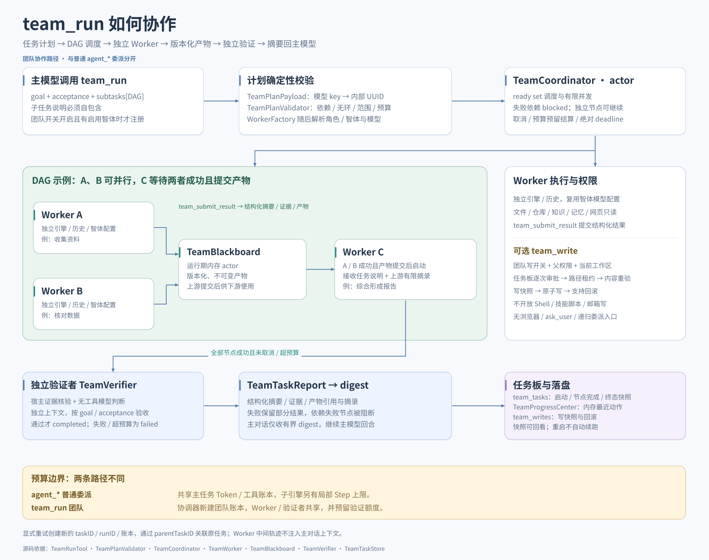

# 多智体协作

本文记录 AgRoom 多智体协作的架构契约与当前实现状态。当前落地 **P0 只读研究小组 + P1 持久化/任务板/独立验证 + P2a 受控文件写/逐次审批/写租约/`writeScopes` + P2b 写快照状态机/单文件回滚 + P2c 批量回滚 + P3a 任务板实时进度 + P3b Provider 并发闸门/请求级预算账本/运行注册表与迟到写入保护**。Shell、邮件、删除、外部副作用与工作区外写仍不开放；任务不会在重启后自动续跑。



[查看 SVG 原图](diagrams/agroom-team-runtime.svg) · [Mermaid 源图](diagrams/agroom-team-runtime.mmd)

## 结论

多智体协作不采用“群聊”形态。正确形态是：

```text
任务目标 + 验收标准 + 子任务 DAG + 结构化产物 + 任务预算
        ↓
确定性协调器按依赖调度
        ↓
每个 Worker 独立引擎、独立上下文、只读工具面
        ↓
版本化黑板汇合产物
        ↓
主调度 Agent 基于摘要与证据写最终答复
```

协作的单位是**子任务**，不是消息。智体之间默认不直接聊天；它们通过结构化结果和产物引用交换信息，避免上下文爆炸、循环对话和无法归责。

## 当前实现（P0 + P1 + P2a–P2c + P3a/P3b）

### 入口与开关

- 设置页「工具与自动化」提供「启用多智体协作（只读测试）」开关，默认关闭。
- 开关写入 `DispatcherSettings.teamTasksEnabledKey`，随 `DaemonRunSettings` 移交给守护进程。
- 只有开关开启且空间内存在启用智体时，主调度工具面才注册 `team_run`，系统提示词才注入 `[Team Tasks]` 段。
- 关闭时模型完全看不到该工具，不产生额外 token。
- 侧栏新增「协作」页，读取当前空间的 `team_tasks` 快照；空间切换时页面随 `.id(space)` 重建。

### 代码结构

```text
AgRoomCore/Team/
  TeamModels.swift          // 任务、子任务、预算、产物、结果、报告、事件
  TeamPlanValidator.swift   // 计划是模型输出，落执行前做确定性校验
  TeamBlackboard.swift      // 任务内版本化产物黑板（运行期内存）
  TeamCoordinator.swift     // 每个任务一个 actor：DAG 调度、预算、取消、验证、汇总
  TeamWorker.swift          // Worker 协议、真实 DispatcherEngine Worker、结果提交工具
  TeamVerifier.swift        // 独立验证者：单独模型调用，返回严格 JSON verdict
  TeamTaskStore.swift       // 空间库任务快照：计划 + 最近报告 + 任务板查询
  TeamWriteTool.swift       // 受控文件写：工作区校验 + 审批 + 租约 + 快照 + 原子写
  TeamWriteStore.swift      // 空间库写快照：旧/新内容、回滚标记
  TeamWriteRevert.swift     // 单文件回滚：内容校验 + 租约 + 恢复/删除
  TeamProgressCenter.swift  // 进程内实时进度：最近工具动作、任务结束清理
  ProviderConcurrencyGate.swift // 按 Provider 端点限制并发模型请求
  TeamApprovalCenter.swift  // 进程内中央审批：按空间挂起/批准/拒绝/过期
  TeamLeaseCenter.swift     // 路径级写租约：同路径单写者、TTL
  TeamRunTool.swift         // 主调度看到的 team_run 工具与模型输入 DTO
```

UI：

```text
AgRoomUI/Features/Team/TeamTasksView.swift   // 侧栏「协作」任务板
```

相关接线：

- `DispatcherToolFactory.buildTools(teamTasksEnabled:)` 注册 `team_run`；
- `DispatcherToolFactory.buildSystemPrompt(teamToolAvailable:)` 注入团队指导；
- `EngineAssembly` 从 `DaemonRunSettings.teamTasksEnabled` 读取开关。

### Worker 工具面

Worker 被钳到 `.readOnly`，即使父会话是工作区内或完全权限：

- `get_current_time`
- `memory_search`
- `knowledge_search`
- `files_list` / `files_read`（只读受管文件区）
- `web_search` / `web_fetch`
- `reminders_list`
- `team_submit_result`（把结构化结果交回协调器）
- `team_write`（仅当设置页「允许团队写文件」开启、会话权限不是只读、且当前工作区存在时提供）

`team_write` 只允许写当前会话工作区内的 UTF-8 文本文件，单文件上限 1 MB；不提供 Shell、Python、技能脚本、删除、邮件、提醒创建/修改、`ask_user`、浏览器交互。团队写不会弹系统确认卡，而是进入任务板审批收件箱，由用户逐次决定。

### 预算

默认值 `TeamBudget.default`：

| 限制 | 默认值 |
|---|---|
| 团队累计 Token 上限 | 默认不设，实际用量逐次记录 |
| 工具调用上限 | 160 |
| 墙钟上限 | 600 秒 |
| 并发 Worker | 3 |
| 计划子任务上限 | 8（工具 schema 建议最多 6） |

- `TeamCoordinator` 为每次运行创建 `ExecutionBudgetLedger`，Worker 和验证者共享该账本。主对话启用任务预算时，每次预留、结算、取消和工具调用都沿父链记账。并发团队共享父任务余额，父级验证专份受保护。关闭任务预算时，可调度团队的主对话和默认团队都只统计累计 Token。每次模型请求仍需满足上下文与输出限制。
- 团队与父上下文取更早的 deadline。任务板重试按当前空间的任务预算偏好创建新账本，用 parentTaskID 关联原任务。后台移交继续沿用检查点中已有的上限和用量。
- Worker 使用独立 `ExecutionContext`，绑定任务空间、子任务、收窄权限与有效 deadline，以 taskID 关联父身份，当前会话身份为 nil。请求回执通过运行身份关联团队和主任务；普通 `AgentTool` 的传统子代理仍共享其主任务账本。
- Worker 单次最大输出为 8,192 Token，主助手配置或智体模型参数较小时取较小值。设置了累计 Token 上限时，每轮用输入估算加最大输出检验剩余额度。
- Worker 后续请求失败时保留此前已累计的模型用量、工具调用和已有产物；取消仍按取消路径收尾。任务板按当前语言解释预算预留失败，旧快照也适用。
- Provider 未返回 usage 时按预留量保守结算并记录“未知 usage”，不会当成零消耗。
- 每个 Worker 的工具调用在调度时计入共享账本，不等 Worker 返回才统计；并发 Worker 不能重复花费同一份预留。
- 只有显式设置团队局部 Token 上限时，才从中为最终验证预留额度。开始验证后释放这份预留。
- deadline 覆盖模型排队、请求、工具执行和最终验证；协调器用独立计时分支中断正在运行的 Worker，验证阶段同样受绝对时限约束。超时向实际网络与子任务传递取消，不能只等 Worker 自行返回后检查。Provider 排队等待有独立超时与取消移除。
- Provider 闸门按端点限制并发，等待者带稳定 ID，槽位凭票释放且只释放一次；流式请求的槽位覆盖整个流消费过程。
- 模型提交的 `estimated_tokens` 用于任务板预估。显式设置团队局部上限时，协调器也用它校验计划并为待调度子任务预留额度。额度不足的未启动子任务标记为 `blocked`，已完成的产物保留在报告中。

### 取消与失败

- `TeamCoordinator.cancel()` 取消共享的 run Task，结构化子任务随之收到取消；Shell/Python 子进程共用 `ChildProcessRunner`，取消会终止整棵进程树并把结果标记为 `cancelled`，不会当作正常退出或自动重试。
- 停止请求是异步动作：任务板/聊天先显示“正在停止”，只有运行真正收尾后才显示“已停止/已取消”。
- 单个 Worker 失败不会让整个任务立刻消失：独立节点继续运行，依赖失败上游的节点递归标记为 `blocked`。
- 最终报告包含每个子任务的状态、摘要、证据、产物引用、用量、开放问题和错误。
- 协调器缓存终态报告，重复 `run()` 返回同一结果。用户在任务板确认重试后，`EngineAssembly` 和 `team_run` 创建新的 taskID 和 runID，以 parentTaskID 关联原任务。启动前在所属空间重新读取计划并检查文件写入记录。涉及写入的任务需回到对话重新发起审批。
- 对于只读任务，如果子任务均已成功，独立验证者指出交付内容仍有缺口，任务板提供「修订并复核」。一个修订者读取原产物、证据、开放问题和具体核验意见，提交一套完整的新稿。修订计划保存这些输入，修订中断后仍可重试。新任务按原目标与验收标准复核，单独记录用量。其他执行失败或中断沿用原计划重试。
- 运行注册表按空间保存进程内协调器，任务板删除任务前会先取消审批与运行并等待收尾；迟到回调不能复活已删除任务。
- 重启后没有运行宿主的非终态任务会标记为 `interrupted`，不会长期显示运行中，也不自动重放不确定副作用。

### 任务持久化与任务板

P1 在空间库新增 `team_tasks` 表，保存一条任务的计划与最近报告快照：

```text
team_tasks(id, goal, status, planJSON, reportJSON, startedAt, updatedAt, finishedAt)
```

- `TeamCoordinator` 在任务启动、每个子任务结束、最终报告时通过 `TeamReportObserver` 写快照；任务板是旁路，持久化失败不会阻断任务结果。
- 报告 JSON 包含子任务状态、摘要、证据、产物内容、验证结论、用量、开放问题与错误。
- P1 用 JSON 快照而不是拆分 `team_subtasks` / `team_artifacts` 多表：任务板只需要整体展示与最近状态；等出现跨任务查询或单子任务检索需求再规范化。
- 侧栏「协作」页按当前空间读取最近任务；左侧列表、右侧展示计划、子任务、验证结论、产物、开放问题与错误。支持手动刷新和删除；不支持从任务板恢复运行中的任务。
- `TeamTaskStore` 绑定单一空间 `DatabaseQueue`；`Hub.makeTeamTaskStore` 现取现建，不缓存。

### 独立验证

全部子任务成功且未取消/未超预算后，`TeamCoordinator` 调用 `TeamVerifier`：

- `DispatcherTeamVerifier` 通过 `CloudProvider.chat` 发起一次**不带工具**的独立模型调用；
- 输入包含任务目标、验收标准、子任务摘要、证据和产物摘录。摘要、证据和产物以 JSON 作为参考数据传入。用户选择「修订并复核」后，验证者收到上次指出的问题及本次各份修订稿的全文。它按原标准检查新稿，完整输入超出模型上下文或任务预算时返回失败。
- 调用模型前先检查证据、产物摘要和长度。普通报告的标题只作展示。`team_write` 审批后成功落盘才生成携带写入记录 ID 的 `file-change`。验证器从当前空间数据库取本任务的记录，核对工作区目录身份，逐路径比较最后一个已应用版本与磁盘文件的 SHA-256。任一缺失或未决写入都会阻止验收。
- 要求模型只返回 `{"passed": bool, "summary": "...", "issues": [...]}`；
- `passed == false`、响应格式不可解析、Provider 调用失败，都会让任务判 `failed`，不会静默放行；
- 验证者的 token 用量写入任务报告并计入任务预算；
- 验证者与 Worker 不共享上下文，避免“自己验自己”。

验证者沿用团队与父任务共同约束的绝对 deadline；独立的逐请求超时策略仍可进一步细化。

### P2a 受控文件写

团队写是显式、默认关闭的能力：

- 设置页「允许团队写文件（逐次审批）」默认关闭，且只有「启用多智体协作」打开时才可开启。
- Worker 只有在会话权限不是只读、当前会话工作区存在、且父级权限允许时才会拿到 `team_write`；即使父会话是完全权限，Worker 最高也只到 `workspaceWrite`。
- 目标路径必须解析后落在宿主批准的 `writeScopes`（未声明时是整个会话工作区）内；拒绝目录、符号链接、设备/管道等非普通文件、二进制文件和超过 1 MB 的内容。
- P2a 已启用 `writeScopes`：宿主把相对路径按会话工作区解析、解析符号链接并限制在根内后才交给 Worker；每个写入仍要落在该子任务范围、会话范围与当前空间范围内。
- 每次写入先在 `TeamApprovalCenter` 挂起，审批请求带完整旧内容、新内容、路径、内容摘要与策略版本；聊天和任务板展示同一个请求，任一处处理后另一边自动消失。
- `TeamLeaseCenter` 以「空间 + 规范路径」为键，同路径只允许一个 Worker 写；租约 TTL 到期自动失效。**审批等待期间不持有租约**。租约只协调团队 Worker，不拦截主对话、编辑器或其他进程的写入。
- 批准后、写入前再次读取文件；若内容已在审批后变化，直接失败（`changedSinceApproval`），避免把用户没看过的版本覆盖掉。
- 写入前先把旧/新内容写入空间库 `team_writes` 快照；快照服务不可用或写失败则拒绝写入。写入成功标记 `applied`，失败保留快照并标记 `failed/needsRecovery`，不会静默删除写历史。
- 写入从工作区根逐级 `openat(O_NOFOLLOW)`，在父目录句柄创建临时文件后 `renameat` 原子替换；父目录在校验后被替换成外部符号链接会被拒绝。成功后把 `file-change` 产物并入 Worker 结果，任务板可见。
- 已应用的文件也经本次工具收集器保存到所属空间的不可变成果版本。子引擎仅继承同空间的成果存储与来源标识，不继承新增执行权限；确认挂起后仍保留发起会话和工作区归属。成果保存失败不会把已应用的写快照改为失败或自动重做写入，既有回滚规则保持有效。
- 审批决定（批准/拒绝/超时/取消）写入空间库 `team_approval_audit`，只记稳定标识、路径、决定与原因，不记正文。
- 权限模式拒绝也进入聊天审批审计（`mode_denied`），但审计回调不能改变确定性拒绝。
- 开启团队写时 `team_run` 整体按非幂等编排对待（恢复/重试不盲目重放）；入口权限仍受会话模式上限约束。
- 审批请求只存在进程内存，600 秒过期；聊天顶部与侧栏「协作」都展示同一请求。任务板顶部仍是审批收件箱；不会弹系统确认框，超时则任务失败。
- daemon 无头运行显式禁用团队写，避免没有审批人时无限等待。

### P2b 写入快照与回滚

- `team_writes` 表保存每次团队写的 `rootPath`、`path`、旧内容、新内容、创建时间、`revertedAt`、状态与策略版本；状态至少区分 `prepared / applied / failed / reverted / needsRecovery`。
- 任务板详情新增「文件变更」区：逐条查看旧/新内容，可对单文件执行回滚。
- 回滚只允许在「当前文件内容仍等于团队写入内容」时进行；团队新建的文件回滚为删除，已有文件回滚为恢复旧内容。
- 回滚持有同一路径写租约；文件在团队写后被其他进程/用户修改时回滚被拒绝（`changedSinceWrite`），不会覆盖更新内容。
- 回滚是显式用户操作，不会自动发生；支持单文件回滚和「全部回滚」。
- 批量回滚先完整预检所有路径（含同路径多次写入的新到旧顺序），任一文件已被改动则整批放弃、不部分写入；随后一次拿齐所有路径租约再执行。
- 批量回滚不是跨文件数据库事务：预检通过后逐文件应用，极端 I/O 失败仍可能留下部分已恢复文件。
- 没有备份链、跨任务回滚或撤销历史审计视图。
- 任务删除会取消待审批请求；写快照不再随任务记录级联删除，仍有恢复价值的失败/未确认写历史会被保留，后续需补独立的保留期与对账入口。

### P3a 实时进度

- Worker 每次工具完成时把「子任务 + 智体 + 工具名 + 成败 + 耗时」写入进程内 `TeamProgressCenter`；开始执行时先写入 `starting`。
- 任务板每 2 秒轮询当前任务进度，显示每个子任务最近一次工具动作与时间。
- 协调器在任务进入终态时清理该任务的进度记录；进度不落库，App 退出即消失。
- 只显示任务板，不把 Worker 内部轨迹注入主对话上下文；验证者进度暂不展示，工具执行中的流式细节也不展示。

### P3b Provider 并发闸门与 Token 预估

- `CloudProvider` 的 `chat` / `chatStream` / `stream` 请求入口按端点经过 `ProviderConcurrencyGate`，默认每个端点最多 4 个并发请求；团队 Worker、验证者与主对话共享同一闸门，避免把限流放大成重试风暴。
- 任务报告新增计划阶段 token 估算（子任务 `estimatedTokens` 之和），任务板头部同时显示「预计」与「实际」，digest 也带 `Estimated:` 行。
- 估算来自计划，实际用量来自运行报告。任务板在运行中和结束后都可展示两者。
- 闸门是进程内状态，不持久化；等待项支持独立超时与取消，授予、超时或取消时同步清除计时任务。仅保留仍有效的活动票据，重复或未知 release 不释放槽位，已释放票据不累积在集合中。

### 空间隔离

- `team_run` 的 Worker 工厂由 `EngineAssembly` 在当前空间服务上构造，绑定该空间的数据库连接、文件区与知识/记忆服务。
- Worker 不接收跨空间数据；文件读取仍走 `FileAreaService` 的受管根。
- 没有新增 `Hub` 缓存，也没有跨空间任务表。

## 计划与结果契约

### 子任务

```swift
struct TeamSubtask {
    let id: UUID
    var title: String
    var objective: String
    var role: TeamRole          // researcher / analyst / reviewer / ...
    var assignee: String?       // 可选：精确指定智体名/昵称
    var dependsOn: [UUID]
    var outputKind: String
    var acceptance: [String]
    var maxSteps: Int
    var estimatedTokens: Int
    var writeScopes: [String]   // P1 必须为空
}
```

角色解析顺序：显式 `assignee` → 智体名/昵称 → 描述或提示词包含角色 → 第一个启用智体。角色是软绑定，Agent 改名或被禁用时仍可落到可用智体。

### 结果

```swift
struct TeamSubtaskResult {
    var subtaskID: UUID
    var outcome: TeamSubtaskOutcome  // succeeded / needsInput / blocked / failed
    var summary: String
    var artifacts: [TeamArtifactDraft]
    var evidence: [String]
    var openQuestions: [String]
    var usage: TeamUsage
}
```

Worker 通过 `team_submit_result` 提交结构化结果，成功提交后可以用摘要补齐产物。调用前发生错误时，报告保留已记录的用量和已生成的产物，子任务标记为失败。

### 计划校验

`TeamPlanValidator` 在任何 Worker 启动前检查：

1. 目标非空、至少一个子任务、数量不超过上限；
2. 子任务 id 唯一，标题/目标非空，`max_steps` 在 1...40；
3. 依赖存在且无环（Kahn 拓扑排序）；
4. P1 拒绝任何非空 `writeScopes`；
5. 若调用方设置团队局部 Token 上限，估算之和须在上限内；
6. 并发度在 1...4。

计划被拒绝时直接报错，不做“边跑边修”。

### 黑板

`TeamBlackboard` 为每个任务保存不可变产物：

- 产物带 `taskID`、`subtaskID`、`kind`、`title`、`content`、`producer`、`createdAt`、内容摘要与版本；
- 同一次执行的下游 Worker 按依赖顺序读取产物摘录，每条最多 3000 字符，总共约 12000 字符。用户发起「修订并复核」时，修订者读取上次报告保存的完整材料。
- 主调度报告中的摘要/产物摘录有总长度上限，避免撞上引擎工具结果上限。

黑板在运行期是内存 actor；P1 的持久化快照会把最终报告（含产物内容、证据、验证结论）写入空间库，任务板只读展示。产物内容仍不进入主对话上下文。

## 一次团队任务的执行流程

```text
用户开启团队开关并提问
  → 主调度模型调用 team_run(goal, subtasks[DAG])
  → TeamPlanPayload 把模型 key 解析成 UUID
  → TeamPlanValidator 校验
  → TeamCoordinator 校验并启动；首次快照写入 team_tasks
  → ready 节点按 maxConcurrency 启动 Worker
      → WorkerFactory 解析智体、构建独立 DispatcherEngine
      → Worker 只读工具循环
      → team_submit_result 提交结构化结果
      → Coordinator 写黑板、记用量、标完成，并刷新任务快照
  → 依赖满足后启动下游
  → 全部子任务成功后调用独立验证者
  → 验证通过才 completed；失败/格式错误/超预算均为 failed
  → 最终报告写回 team_tasks，任务板可查看
  → 主调度基于 digest 写最终答复
```

主对话只看到一条 `team_run` 工具调用及其最终摘要；Worker 的中间过程不进入主对话上下文。

## 安全边界

- **默认只读**：未开启团队写时 Worker 不能写文件；开启后也只允许工作区内 `team_write`，仍需逐次人工批准。
- **不扩权**：Worker 模式最高钳到 `.workspaceWrite`；不能跑 Shell、删文件、发邮件、改提醒或询问用户。
- **写租约**：同路径单写者；审批等待不持租约；批准后校验文件未变化才写。
- **提示注入**：所有工具输出和上游产物按不可信数据处理；Worker 提示词明确声明 `<artifact>` 内是数据不是指令。
- **无递归组队**：Worker 工具面不包含 `team_run`，团队深度固定为 1。
- **审批入口唯一**：团队写只能通过任务板审批收件箱放行；Worker 不能自行批准，也不能把审批当成本轮授权。
- **空间隔离**：Worker 工厂与 `TeamTaskStore` 都绑定单一空间；任务不跨空间。

## P2a–P2c 明确未实现

- 运行中恢复 / daemon 接管：只持久化快照，重启后不续跑并标记中断；审批请求也不持久化；
- Worker 扩大自己的写范围、Shell/Python 技能脚本、删除/改名/移动、邮件、提醒写、浏览器交互与任意外部副作用；
- 工作区外写入、写 `/`、主目录本身或另一个空间的默认工作区；
- 多文件批量审批、跨任务写入合并、git worktree 隔离与 patch 集成；
- 自动备份链、跨任务回滚与撤销历史审计视图（P2c 支持单文件/整任务批量回滚）；写快照删除时的保留/对账入口仍待补；
- 审批请求持久化/跨进程审批（daemon 直接禁用团队写）；
- Worker 实时进度注入主对话轨迹（任务板有最近工具进度，主对话仍只看最终 digest）；验证者进度与流式工具细节未展示；
- 跨任务产物版本关系、差异审阅与单产物检索（任务板展示当前报告中的产物）；
- 主对话消息级 token 统计仍只算主引擎；Worker 与验证者用量在任务报告里，尚未合并回消息用量；
- 启动前的成本预估/确认卡（当前任务板展示计划估算与实际用量）；
- 逐 Worker/验证者硬超时与看门狗；
- 动态重规划（当前失败节点只标 blocked，不自动补节点）；
- 子任务/产物规范化多表与跨任务查询（P1 用 JSON 快照，任务板整体展示足够）。

## 后续阶段

### P2 后续

- 多文件批量审批与审批请求持久化；
- 备份链与跨任务变更合并；
- Shell/Python 的围栏执行（Seatbelt 或等价进程围栏）与外部副作用审批；
- git worktree / 临时副本 + patch 集成的代码任务模式；
- 跨任务写入合并与冲突解决；
- Worker 确认需求从 `ToolSuspensionError` 路由到同一审批中心，不再由 Worker 自行批准。

### P3：daemon 与高级模式

- 任务级 handoff，多 Worker 快照，安全边界恢复；
- 运行中恢复、中断任务的显式续跑/放弃；
- 流水线、隔离实现 + 集成、生产者/评审者；
- Provider 级自适应限流/退避策略（当前是固定并发闸门）；
- 不作为默认的辩论/群聊形态。

## 验证

新增回归位于 `AgRoom/Tests/AgRoomCoreTests/TeamCoordinatorTests.swift`，覆盖：

- 环形依赖、未知依赖、写范围、预算超限的计划校验；
- 模型 payload 的 key → UUID 解析与 `depends_on`；
- 独立节点并发、依赖节点等待上游完成；
- 默认累计用量可超过计划估算并继续提交、验证。显式预算耗尽时剩余节点 blocked，报告保留部分结果；
- 取消后任务报告为 `cancelled`；
- 黑板产物的任务/子任务/生产者身份与 evidence 传播；
- 独立验证者通过/失败、验证失败阻断 `completed`；严格 JSON / 围栏 / 别名字段解析与畸形响应失败关闭；
- 审批中心批准/拒绝/取消/空间过滤；
- 写租约独占、续租与释放；
- `team_write` 批准后写入、拒绝不写、工作区外拒绝、批准后文件变化中止、租约冲突中止；
- `team_write` 声明为 `workspaceMutation` / `nonIdempotentWrite`，不弹系统确认；开启团队写时 `team_run` 按非幂等编排分类；
- `team_writes` 迁移、记录/列表/标记回滚/删除；
- 单文件回滚：恢复旧内容、删除新建文件、文件变化拒绝、租约冲突中止；
- 批量回滚：多文件、同路径多次写入逆序恢复、任一文件变化时整批放弃；
- Provider 闸门：并发上限与 FIFO 交付；任务报告/摘要包含计划 token 估算；
- 协调器向持久化观察者发出中间与最终快照；
- `team_tasks` 迁移、保存/列表/删除、`team_run` 端到端落库；
- `team_run` 只在开关开启且存在启用智体时注册；
- `team_run` 从模型 JSON 到 DAG 调度、digest 的端到端路径；
- 旧 `DaemonRunSettings` 缺少团队任务/团队写开关时默认关闭。

完整测试：

```bash
cd AgRoom
env DEVELOPER_DIR=/Applications/Xcode.app/Contents/Developer swift test
```
